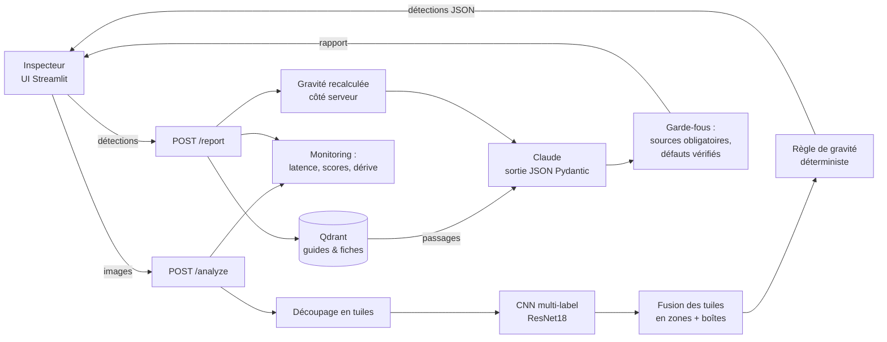

# Détection de défauts sur chantier + assistant LLM

Repérer automatiquement les défauts visibles sur des images de béton (fissures, éclatements, armatures
apparentes, corrosion, efflorescences) et produire un **rapport d'inspection clair, sourcé et prudent**.

## Besoin métier

Un conducteur de travaux ou un inspecteur d'ouvrages veut, à partir de photos prises sur site :

1. repérer rapidement les zones qui présentent un défaut ;
2. savoir lesquelles traiter en priorité ;
3. obtenir un rapport lisible avec des actions à mener, justifiées par une documentation technique.

L'outil est une **aide à la décision** : il trie et documente, et un humain qualifié valide.

## Périmètre

| | |
|---|---|
| **Entrée** | une image ou un lot d'images (JPEG/PNG) |
| **Sortie** | défauts détectés (type, position, score), gravité estimée, rapport texte avec sources |
| **Hors périmètre** | mesure en mm (ouverture et profondeur de fissure), 3D/BIM, diagnostic structurel |

## Architecture



Détails et choix de conception : [docs/architecture.md](docs/architecture.md) et [docs/decisions.md](docs/decisions.md).

## Données

| Dataset | Contenu | Usage ici |
|---|---|---|
| [CODEBRIM](https://zenodo.org/records/2620293) | Défauts de ponts en béton, multi-label : fissure, éclatement, efflorescence, armatures apparentes, traces de corrosion | Modèle principal (multi-classes) |
| [SDNET2018](https://digitalcommons.usu.edu/all_datasets/48/) | Patches 256×256 fissuré / non fissuré (tabliers, murs, chaussées) | Indexation prise en charge (`data.index sdnet2018`) pour une variante binaire ; non évalué ici, aucun résultat publié |

> ⚠️ Vérifie la licence de chaque dataset sur sa page avant téléchargement et cite-la si tu publies.
> Les données ne sont pas versionnées (`data/` est ignoré par Git).

Arborescence attendue :

```
data/raw/SDNET2018/{D,W,P}/{CD,UD,CW,UW,CP,UP}/*.jpg
data/raw/CODEBRIM_classification_dataset/…/*.png + metadata/*.xml
```

**Anti-fuite de données.** Les patches d'une même photo se ressemblent fortement. Chaque patch est
rattaché à sa photo source (`group`), et le split train/val/test (70/15/15, graine fixe) est **groupé**
par photo source et stratifié par classe : aucune photo n'a de patches dans deux splits (vérifié par un test).

## Méthode

1. **Baseline classique** : histogrammes HSV, HOG, LBP et features morphologiques (black top-hat,
   squelette, contours), puis Random Forest pondéré. C'est le point de comparaison.
2. **Deep learning** : transfer learning ImageNet en multi-label. Le code accepte ResNet18, ResNet50
   et EfficientNet-B0 (`--arch`), mais seul **ResNet18** a été entraîné et évalué. L'entraînement se fait
   en deux temps (tête seule, puis dégel du dernier bloc), avec des augmentations qui simulent le
   chantier (flips, rotations, luminosité/contraste, léger flou). Le déséquilibre est traité par
   BCE pondérée ou focal loss, que l'on compare. Les runs sont suivis dans MLflow.
3. **Seuils orientés métier** : un défaut manqué coûte plus cher qu'une fausse alerte. Les seuils
   par classe sont choisis sur la validation en maximisant le **F2**, qui favorise le rappel.
4. **Inférence sur photo entière** : découpage en tuiles de 256 px, classification, puis fusion des
   tuiles positives voisines en zones, qui donnent la boîte, le score et l'étendue.
5. **Gravité** : une règle déterministe combine le type de défaut, l'étendue relative et le nombre de
   zones pour donner `faible` / `moyen` / `élevé` ([severity.py](src/chantier_defects/severity.py)).
   **Le LLM ne décide pas de la gravité, il rédige.**
6. **Rapport LLM + RAG** : les détections JSON et les passages récupérés dans Qdrant (guides
   d'inspection, fiches de pathologies) sont envoyés à Claude, qui renvoie un rapport en JSON validé
   par Pydantic : résumé, défauts localisés, actions, incertitude.
7. **Garde-fous** : la gravité est recalculée côté serveur. Une recommandation sans source réellement
   récupérée est supprimée, tout comme un défaut absent des détections. Le rapport porte la mention
   « validation humaine requise ». Si le LLM est indisponible, un rapport déterministe prend le relais.

## Résultats

Jeu de test : 1 016 patches CODEBRIM (196 photos sources jamais vues à l'entraînement). Tableau généré par
`python -m chantier_defects.eval.compare reports/baseline reports/<run>` à partir des fichiers `metrics_test.json`.

| Modèle | F1 macro | Rappel macro | PR-AUC macro | Rappel « au moins un défaut » |
|---|---|---|---|---|
| Baseline RF (features classiques) | 0.633 | 0.885 | 0.711 | 0.996 |
| ResNet18 + BCE pondérée | 0.716 | 0.923 | 0.837 | 0.991 |
| ResNet18 + focal loss | 0.732 | 0.895 | 0.841 | 0.994 |

**Modèle déployé** : ResNet18 + BCE pondérée (`models/model.pt`). Il a le meilleur rappel macro, critère
prioritaire ici ; la focal loss donne un F1 macro un peu meilleur mais rate davantage de défauts
(rappel fissure 0.961 contre 0.931, mais rappel efflorescence 0.717 contre 0.828).

**Analyse d'erreurs, classe « fissure »** (modèle déployé, planches dans `docs/figures/`, générées par
`chantier_defects.eval.errors`) :

1. **Faux négatifs** (`errors_crack_fn.png`, 23 fissures manquées sur 332) : 17 des 23 patches portent aussi
   une autre étiquette (13 des traces de corrosion, 8 de l'efflorescence, 5 un éclatement). Visuellement,
   la fissure y est souvent secondaire : coulure de rouille, armature ou épaufrure qui domine le patch, ou
   fissure fine et peu contrastée sur un béton taché. Le modèle reconnaît alors le défaut dominant et
   « oublie » la fissure. Quelques patches très étroits (quelques dizaines de pixels de large) sont
   déformés par le redimensionnement en 224×224.
2. **Faux positifs** (`errors_crack_fp.png`, 182 fausses alertes) : 136 sont des patches d'autres défauts
   (éclatement, corrosion…), dont les bords de cavité et les arêtes d'épaufrure ressemblent à des fissures ;
   43 viennent d'images de fond. Parmi les alertes les plus confiantes, plusieurs patches montrent ce qui
   ressemble à une vraie fissure, ce qui suggère du **bruit d'étiquetage** dans CODEBRIM. On trouve aussi
   de la peinture écaillée et des tags.

Ce compromis est voulu : les seuils calés sur le F2 favorisent le rappel (92.3 % de rappel macro, 99.1 %
sur « au moins un défaut », soit 6 patches défectueux non signalés sur 676). Cela ne garantit pas
l'absence d'oubli sur site, d'où la validation humaine obligatoire.

## Lancement

### 1. Environnement (Python 3.11 ou 3.12)

```bash
python -m venv .venv
.venv\Scripts\activate            # Windows  (Linux/macOS : source .venv/bin/activate)
# PyTorch : choisir la roue CPU ou CUDA sur https://pytorch.org/get-started/locally/
pip install torch torchvision --index-url https://download.pytorch.org/whl/cpu
pip install -e ".[dl,api,llm,ui,dev]"
copy .env.example .env            # puis renseigner ANTHROPIC_API_KEY
```

### 2. Données, baseline, deep learning

```bash
python -m chantier_defects.data.index codebrim data/raw/CODEBRIM_classification_dataset data/processed/index.csv
python -m chantier_defects.data.split data/processed/index.csv data/processed/splits.csv --seed 42
python -m chantier_defects.models.baseline data/processed/splits.csv --out models/baseline.joblib
python -m chantier_defects.models.train data/processed/splits.csv --arch resnet18 --loss weighted   # -> models/model.pt (déployé)
python -m chantier_defects.models.train data/processed/splits.csv --arch resnet18 --loss focal --out models/model_focal.pt
python -m chantier_defects.eval.compare reports/baseline reports/resnet18-weighted reports/resnet18-focal
python -m chantier_defects.eval.errors reports/resnet18-weighted/predictions_test.csv crack --kind fn
mlflow ui                          # suivi des expériences sur http://localhost:5000
```

Exploration : [notebooks/01_exploration.ipynb](notebooks/01_exploration.ipynb).

### 3. Base documentaire, API, interface

```bash
docker compose up -d qdrant
python -m chantier_defects.llm.rag ingest knowledge/      # voir knowledge/README.md
uvicorn chantier_defects.api.main:app --reload            # http://localhost:8000/docs
streamlit run src/chantier_defects/ui/streamlit_app.py
```

Sans clé `ANTHROPIC_API_KEY`, l'API fonctionne quand même : les rapports sont produits par un gabarit
déterministe (`generated_by: "template"`).

### 4. Tout en conteneurs

```bash
docker compose up --build          # API (port 8000) + Qdrant (port 6333)
python -m chantier_defects.llm.rag ingest knowledge/   # indexe la base dans le Qdrant du compose (CHANTIER_QDRANT_URL)
```

### 5. Tests

```bash
pytest
```

Les tests utilisent des images synthétiques et des doublures du modèle, du LLM et de la base
documentaire. Ils ne demandent ni données, ni clé API, ni réseau.

Un contrôle de bout en bout contre la vraie API Claude est disponible à part (payant, quelques centimes) :
`pytest -m slow tests/test_live_claude.py`, avec `ANTHROPIC_API_KEY` définie.

### Déploiement Google Cloud Platform (GCP)

Voir [docs/deploy_gcp.md](docs/deploy_gcp.md) : Google Artifact Registry + Google Cloud Run (serverless),
secrets gérés dans Google Secret Manager, CI/CD GitHub Actions.

## Limites

- **Dataset public**, donc pas représentatif de tous les chantiers : types de béton, éclairages,
  appareils photo et défauts réels varient davantage.
- **Pas de validation avec des experts du métier** : les étiquettes et les seuils n'ont pas été
  revus par des inspecteurs d'ouvrages.
- **La gravité est estimée par une règle simple**, pas par une norme officielle ; ses seuils sont des
  hypothèses de travail documentées dans le code.
- La classification par tuiles localise à la résolution d'une tuile (256 px), sans contour précis du
  défaut ni mesure dimensionnelle.
- La qualité des recommandations dépend directement des documents indexés dans la base RAG.
  La base contient un extrait officiel du FHWA (SNBI 2022, grille de gravité des défauts du béton) et deux
  **synthèses non vérifiées**, à remplacer par des extraits officiels (voir [knowledge/README.md](knowledge/README.md)).
  Les seuils du SNBI sont donnés en pouces et sont propres à la pratique américaine.

## Mentions

- Les données et les documents de la base RAG restent soumis à leurs licences respectives.
- L'approche détection YOLO (ultralytics) est volontairement écartée de ce dépôt : ultralytics est
  sous licence **AGPL-3.0**, ce qui imposerait de publier sous AGPL tout service qui l'intègre.
