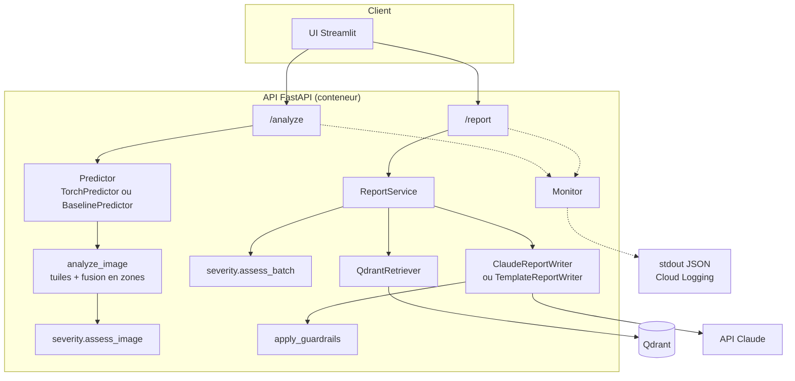
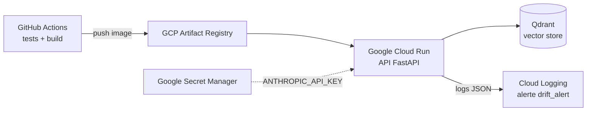

# Architecture

> Schéma de référence en Mermaid, rendu directement par GitHub. Pour la version draw.io demandée en
> livrable, reproduire ce schéma et exporter `docs/architecture.drawio.png`.

## Vue logique



## Vue déploiement (Google Cloud Platform - GCP)



## Organisation du code

```
src/chantier_defects/
├── config.py          paramètres (variables d'environnement CHANTIER_*)
├── labels.py          classes, libellés FR, requêtes RAG par défaut
├── schemas.py         contrats Pydantic partagés
├── severity.py        règle de gravité déterministe
├── monitoring.py      latence, scores, alerte de dérive
├── tracking.py        MLflow optionnel
├── data/              index des datasets, split groupé, Dataset PyTorch + augmentations
├── models/            features + baseline RF, CNN + entraînement, inférence par tuiles
├── eval/              métriques métier, planches d'erreurs, tableau comparatif
├── llm/               RAG (Qdrant + fastembed), génération du rapport + garde-fous
├── api/               FastAPI
└── ui/                Streamlit
```

> Écart assumé avec le plan initial (`src/data`, `src/models`…) : les sous-modules sont regroupés dans
> un package `chantier_defects` installable (`pip install -e .`). Cela évite les imports relatifs
> fragiles et les collisions de noms (un package nommé `data` ou `models` masquerait d'autres modules).
